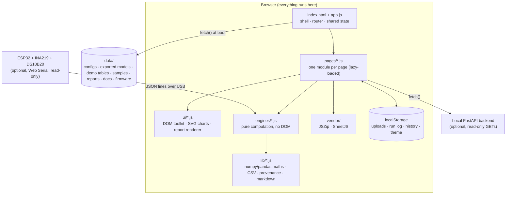
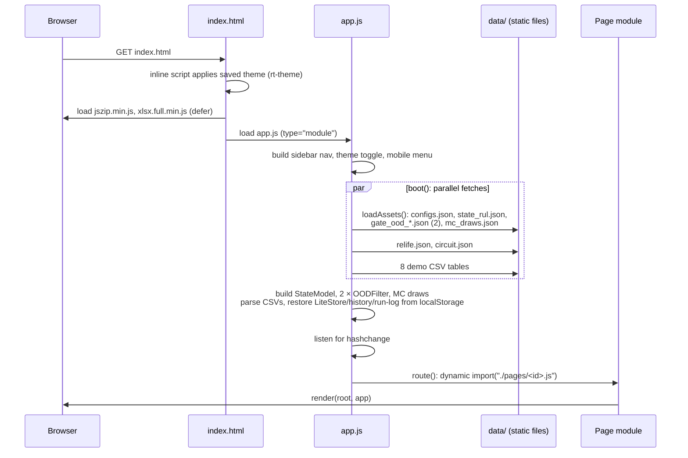
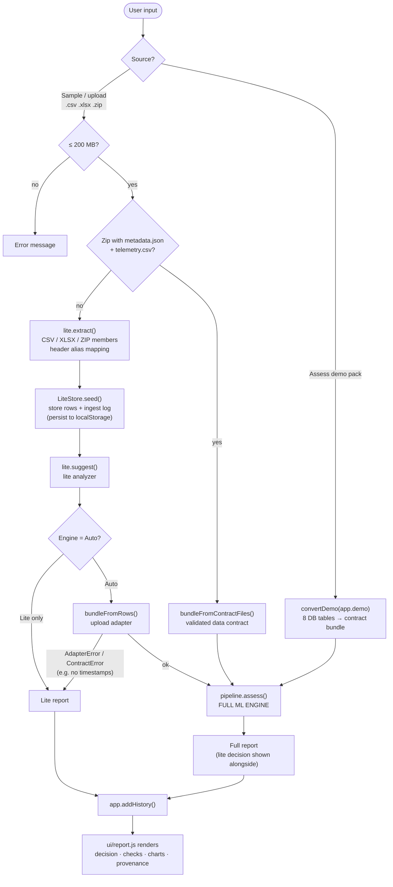
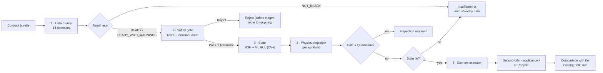
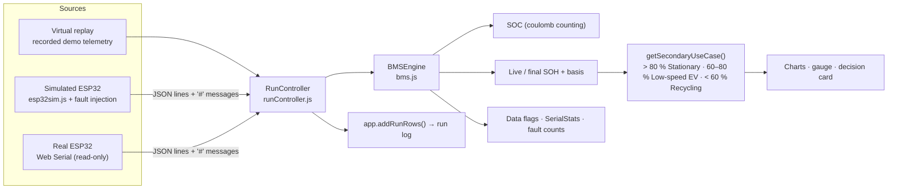
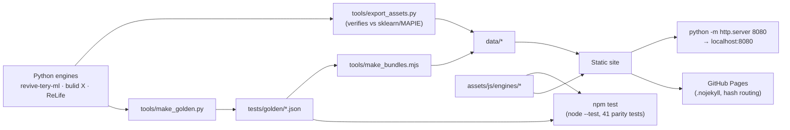

# REVIVE-TERY Studio: How the Web App Works

This document explains how the REVIVE-TERY Studio web app works. It covers how the page starts up, how data moves through each engine, what each page does, and which software, libraries and tools it is built with.

> **Scope and honesty.** Every REVIVE-TERY dataset in the app is **synthetic** or **simulated**. The results show that the pipeline works. They say nothing about a real battery. The safety gate is **UL 1974-style triage**: a screening step, not UL certification or a safety approval.

---

## 1. What the app is

REVIVE-TERY Studio is a **second-life battery triage studio** that runs entirely in the browser. It takes battery telemetry (uploaded files, demo database tables, a simulated ESP32 bench, or a real ESP32 over USB) and decides what the battery should do next:

- **Second-Life** use, either stationary storage or low-speed EVs,
- **Recycle**,
- **Inspection required** (quarantine), or
- **Insufficient or untrustworthy data**: the app refuses to decide and gives the reason.

Key design properties:

| Property | How it is achieved |
|---|---|
| No server, no build step | Plain HTML + native ES modules + JSON/CSV data files, served as static files |
| Nothing is uploaded | Every engine runs in browser JavaScript. Uploaded files are read with the `File` API and stay in memory or `localStorage` |
| Same answers as the Python originals | Engines are line-by-line ports, checked against golden outputs from the Python engines (`npm test`) |
| No invented values | Every number carries a **provenance tag** (`measured`, `synthetic`, `modelled`, `assumed`). Missing data leads to a fallback or a refusal with a reason |
| Hardware is monitor-only | The serial wrapper has no write method. DTR/RTS are held low so the ESP32 doesn't reset |

---

## 2. High-level architecture



### Folder layout

```
index.html                 app shell (sidebar, top bar, content area)
assets/css/app.css         styles, light and dark themes
assets/js/app.js           router, shared state, asset loading, persistence
assets/js/engines/         ported engines (no DOM; also imported by the Node tests)
assets/js/pages/           one module per page
assets/js/ui/              DOM helpers, SVG charts, report renderer
assets/js/lib/             numerics, CSV, provenance tags, markdown
assets/vendor/             JSZip 3.10.1 (MIT), SheetJS 0.18.5 (Apache-2.0)
data/                      configs, exported models, demo tables, samples, reports, docs, firmware
tests/                     Node parity tests + golden outputs
tools/                     Python/Node scripts that export data and golden outputs
```

---

## 3. Startup workflow (boot sequence)



Step by step:

1. **`index.html`** draws the shell: a sidebar with the nav, a top bar with a "Synthetic data" pill and a theme toggle, and a `#content` area that shows *"Loading engines and models…"*. A small inline script applies the saved theme before first paint, so the page doesn't flash.
2. **Vendor scripts** (JSZip, SheetJS) load with `defer`. They are classic scripts and expose `window.JSZip` and `window.XLSX`.
3. **`app.js`** (ES module) builds the nav from the `PAGES` table, wires up the theme and menu buttons, then calls `boot()`.
4. **`boot()`** fetches everything at once with `Promise.all`:
   - `loadAssets()` from `engines/pipeline.js` reads `data/configs.json` and the three model files, then builds a `StateModel`, two `OODFilter`s (`synthetic_packs`, `measured_cells`) and the 1,000 Monte Carlo parameter draws.
   - `data/relife.json` (ReLife adapters, scenarios, catalog) and `data/circuit.json` (bench wiring).
   - The 8 demo tables in `data/demo/*.csv`, parsed by `lib/csv.js`.
   - Restores the `LiteStore` (uploaded telemetry and ingest log), the assessment `history` and the bench `runLog` from `localStorage`.
5. If boot fails, for example because the page was opened from `file://` where browsers block ES modules, a banner explains how to serve the folder over HTTP.
6. **Routing** uses the URL hash (`#/analyze`), so GitHub Pages needs no rewrite rules. On every `hashchange`, `route()`:
   - calls the old page's `unmount()` if it has one (stops timers and serial reads),
   - shows a spinner, dynamically `import()`s the page module (lazy loading), and calls `render(root, app)`.
7. Changing the theme re-renders the current page, because the SVG charts read colours from CSS variables when they draw.

### Shared state (`app` object in `app.js`)

| Field | Contents |
|---|---|
| `assets` | configs, `stateModel`, `gates`, `mcParams` (from `loadAssets`) |
| `demo` | the 8 demo tables as row objects |
| `relife`, `circuit` | ReLife data and the bench circuit |
| `liteStore` | uploaded telemetry and ingest log (stands in for DuckDB `ml_telemetry` / `ml_ingest_log`) |
| `history` | last 50 assessments (persisted) |
| `runLog` | bench readings (up to 20,000 in memory, last 5,000 persisted) |
| `libs()` | returns `{ JSZip, XLSX }` |
| `getBundles()` | lazy-loads `data/bundles.json` for the Data-quality lab |

All `localStorage` keys are prefixed `rt-` and every access is wrapped in `try/catch`. If storage is blocked, the app still works for the current visit.

---

## 4. Pages and what each one does

| # | Page (route) | Module | Engines used | Purpose |
|---|---|---|---|---|
| 1 | Overview (`#/overview`) | `pages/overview.js` | — | What REVIVE-TERY does, the decision flow, the provenance legend, a list of engines |
| 2 | Circuit Studio (`#/bench`) | `pages/bench.js` | `runController`, `bms`, `esp32sim` | Bench circuit diagram, three reading sources, live BMS engine, SOC/SOH, decision |
| 3 | Analyze batteries (`#/analyze`) | `pages/analyze.js` | `lite`, `contract`, `pipeline` (+ all full-engine stages) | Upload `.csv/.xlsx/.zip`, map columns, run the lite and/or full ML engine |
| 4 | Data-quality lab (`#/dqlab`) | `pages/dqlab.js` | `contract`, `pipeline` | Run the full engine on reference bundles and injected faults; edit metadata and re-run |
| 5 | Physics projection (`#/physics`) | `pages/physics.js` | `physics` | Sandbox: SOH now + remaining cycles → life projection under a chosen workload |
| 6 | Economics (`#/economics`) | `pages/economics.js` | `econ`, `physics` | What-if for one pack; illustrative metal-price sensitivity sweep |
| 7 | Database (`#/database`) | `pages/database.js` | — | View/export the 8 demo tables, uploads, run logs and assessment history as CSV |
| 8 | Model evidence (`#/evidence`) | `pages/evidence.js` | `lib/md` | Validation reports (`data/reports/*.json`) and model cards (`data/docs/*.md`) |
| 9 | ReLife BMS Studio (`#/relife`) | `pages/relife.js` | `relife` | Adapter compatibility, scenario evaluation, 30 s virtual pulse test |
| 10 | Firmware & hardware (`#/hardware`) | `pages/hardware.js` | `esp32sim`, `bms` constants | ESP32 sketch, wiring, line protocol, safety limits; download `.ino` |
| 11 | Backend connector (`#/backend`) | `pages/backend.js` | — | Read-only calls to the optional local FastAPI backend |

---

## 5. Main workflow: assessing a battery

This is the core user journey on the **Analyze batteries** page.



### 5.1 Inputs the user supplies ("What the data can't tell us")

Chemistry (LFP/NMC/NCA), series cells, parallel cells, rated capacity (Ah), nominal voltage (V), data provenance (synthetic/simulated/measured), and the engine mode (Auto or Lite only). The defaults (LFP, 16S, 100 Ah) match the bundled samples.

### 5.2 Ingestion (`engines/lite.js`, `engines/contract.js`)

- **Extraction:** `.csv` is parsed with delimiter sniffing (`lib/csv.js`), `.xlsx/.xls` with **SheetJS**, `.zip` with **JSZip** (max 500 members, 2 GB uncompressed).
- **Column mapping:** an explicit alias table (`COLUMN_ALIASES`) maps headers such as `pack_voltage_v`, `voltage`, `v` → `voltage_v`. **Unknown columns are reported, never guessed.**
- **Storage:** rows go into the `LiteStore` under a new `ingest_id`. If the same file is uploaded again, only its latest copy is kept.
- **Contract bundles:** a zip containing `metadata.json` + `telemetry.csv` skips the lite path. It is validated against the **data contract** (port of pydantic + pandera schemas): required columns `asset_id, timestamp_utc, voltage_v, current_a, temperature_c`, allowed chemistries and provenances, and no extra metadata fields.
- **Upload adapter** (`bundleFromRows`, port of `ml_engine_bridge.py`): turns stored rows into a contract bundle (≥ 95 % timestamp coverage needed, up to 50 capacity tests sampled). If it can't, it throws and the app falls back to the lite result with the reason.

### 5.3 The full ML engine pipeline (`engines/pipeline.js → assess()`)



#### Stage 1: Data quality (`engines/dq.js`)

Fourteen detectors run on time-sorted, de-duplicated rows. Current is **never flipped**: checks that depend on direction work in a "charge-positive" frame based on the declared or inferred sign convention.

| # | Check id | What it detects |
|---|---|---|
| 1 | `sample_size` | Too few rows or too short a duration |
| 2 | `provenance` | Data labelled measured but isn't, or synthetic data |
| 3 | `timestamps` | Fewer than two distinct timestamps, gaps, disorder |
| 4 | `sign_convention` | Current sign convention unknown or contradicted |
| 5 | `charge_balance` | SOC change vs integrated current (implied capacity) |
| 6 | `regen_sign` | Regen/charging rows not opposing driving rows |
| 7 | `resistance` | Resistance tests outside the plausible range |
| 8 | `sensor_nulls` | Null fractions per channel |
| 9 | `sensor_dropouts` | ~0 V voltage dropouts |
| 10 | `sensor_stuck` | Frozen channels (voltage, SOC, temperature) |
| 11 | `sensor_spikes` | Isolated spikes (Hampel filter) |
| 12 | `sensor_range` | Physically impossible readings |
| 13 | `temperature_missing` | Temperature absent for some or most live rows |
| 14 | `estimate_disagreement` | Live SOH vs capacity-test SOH disagreement |

**Readiness** uses explicit rules, not a weighted score:
- **R1:** any `fail` → `NOT_READY` (the pipeline stops)
- **R2:** else any `warn`/`inconclusive` → `READY_WITH_WARNINGS`
- **R3:** else → `READY`

Inconclusive checks are excluded from the decision. For example, an inconclusive resistance check makes the state model impute resistance.

#### Stage 2: Safety gate (`engines/gate.js`)

1. **Deterministic chemistry limits** (`configs.limits`): cell voltage (pack V / series) below the minimum or above the maximum, on enough rows → **Reject**.
2. **Out-of-distribution / sensor-noise filter**: an **IsolationForest** exported from scikit-learn. Telemetry is cut into windows (20 rows, stride 10). Eight features are computed per window (`v_level`, `c_rate_rms`, `resid_mad_mv`, `resid_max_z`, `resid_mean_t`, `temp_slope_c_per_min`, `temp_resid_z`, `v_repeat_frac`), scaled, and scored. Too many flagged windows → **Quarantine**.
   - Packs (>1 cell) use the `synthetic_packs` model. Single cells use the `measured_cells` model.
3. Open high-severity safety events → **Quarantine**. Otherwise → **Pass**.

#### Stage 3: State estimate (`engines/state.js`)

- **SOH** = latest measured capacity test ÷ rated capacity. With no capacity test, the result is `insufficient` and the SOH cannot be anchored.
- **Remaining useful life (RUL)**: a **HistGradientBoosting** regressor on field features (trained on Severson LFP cells), wrapped in **MAPIE CV+** for a prediction interval. The browser runs the 5 exported fold models plus the conformity scores.
- **ML → physics hand-over:** fade rate = (SOH − 0.80) ÷ predicted RUL, with conservative and optimistic versions from the interval bounds.
- If SOH ≤ 80 % (below the training range) or no model is available, the stage falls back to the capacity-test trend.
- Warns when the chemistry or features fall outside the training distribution (`out_of_distribution`).
- Also records the **existing REVIVE-TERY rule** (SOH > 80 % → stationary, 60–80 % → low-speed EV, < 60 % → recycle), shown for comparison only.

#### Stage 4: Physics projection (`engines/physics.js`)

For each workload in `configs.workloads`:

```
SOH_cyc(m) = SOH0 · [ (1 + ε)·e^(−β·m) − ε·e^(δ·m) ]      double-exponential fade
m(n)       = n · S_T · S_DoD · S_C                          stress scaling (temperature, depth of discharge, C-rate)
SOH(t)     = SOH_cyc(m(t)) − k_cal · S_Tcal · √t_years      calendar ageing
```

β is solved so the curve reaches 80 % at the ML-predicted RUL under reference conditions. The output contains:
- a **central** trajectory, an **ML band** (from the CV+ bounds), a **knee scenario**,
- a **Monte Carlo band**: 5th–95th percentile over **1,000 physics-parameter draws**, labelled *assumption-conditional, not a measured interval*,
- years until the workload's minimum SOH, and **conservative years** = min(ML lower bound, MC p05).

#### Stage 5: Economics router (`engines/econ.js`)

- **Recycle value:** metal content (Ni, Co, Li per kWh by chemistry) × prices × recovery rate × payable fraction − processing cost. Lithium is priced via Li₂CO₃.
- **Second-life value per application:** discounted energy value over the conservative years, **capped at the cost of buying new storage** for the same service, minus upfront costs, plus end-of-life recycle value at present value. LCOS is shown for comparison.
- **Decision:** the best second-life option wins if its net value is greater than recycling now **and** it has ≥ 1 conservative year. Otherwise → **Recycle**.
- Placeholder cost inputs are listed explicitly in the rationale.

### 5.4 The lite analyzer (`engines/lite.js`)

A simpler path used when timestamps or the contract are missing, or when the user picks "Lite only":

1. **Data quality:** null fractions; whether capacity and temperature data exist.
2. **Safety gate:** chemistry cell-voltage and temperature limits → Reject. Temperature jumps, ~0 V dropouts, or no temperature data → Quarantine.
3. **State:** resistance proxy |dV/dI|, SOH = median of the last 5 cycle capacities ÷ rated, linear fade over up to 50 cycles, cycles to 60 % end-of-use (flagged as optimistic).
4. **Economics:** a simple second-life vs recycle suggestion.

With no capacity column there is **no SOH** ("voltage alone is not enough").

### 5.5 Output and rendering (`ui/report.js`)

Reports show the decision card, rationale, warnings, every DQ check with its status pill, gate details, state, projection charts (with bands), economics tables, and the comparison with the existing rule. Every number is shown with its **provenance tag**. Each assessment is added to the history (Database page), and the report can be downloaded.

---

## 6. Circuit Studio workflow (bench / BMS engine)



1. **Pick a source** and a battery:
   - **Virtual replay:** the demo pack's recorded rows, replayed in time order (`replaySamples`). Nothing is invented.
   - **Simulated ESP32** (`SimulatedESP32`): a software model of a 1S Li-ion cell (OCV curve, 0.10 Ω internal resistance, thermal mass), a constant-current load, an INA219 (4 mV / 0.1 mA resolution, 26 V limit, 3.2 A range) and a DS18B20, with noise. It runs at 1–600× speed. **Fault injection:** INA219 wire loose, DS18B20 disconnected, +22 V over-voltage, 3.5 A over-current, ESP32 goes silent. It emits exactly the same JSON lines and `#` messages as the real firmware.
   - **Real ESP32** over **Web Serial** (Chrome/Edge desktop, https or localhost). `ReadOnlyPort` can only read lines and close. DTR/RTS are held low.
2. **Each line** goes through `handleSerialLine()`. Telemetry lines `{"voltage":…,"current":…,"temperature":…}` become samples. `#` lines are firmware messages, classified by severity and counted in `SerialStats`.
3. **`BMSEngine.process()`**:
   - **SOC** by coulomb counting: `SOC(t) = SOC(t−1) − I·dt / capacity` (clamped to 0–100).
   - **SOH** with an explicit basis: *measured* (full discharge to cutoff), *estimate* (Ah ÷ ΔSOC once ΔSOC ≥ 5 %), *lower bound* (Ah so far), or *waiting*.
   - Data flags: DS18B20 −127 °C means disconnected, SOC disagreement > 10 points, firmware faults during the test.
4. **Decision:** the screening rule based on capacity alone, with a note that real reuse needs safety, resistance and cell-level testing by a qualified engineer.
5. Readings are appended to the run log (Database page → `test_run_log`).

---

## 7. Other workflows

### Data-quality lab
Loads `data/bundles.json` (the demo pack, clean LFP/NMC packs, gate cases, and every injected data-quality fault). You pick a bundle, optionally edit its metadata, and re-run `assess()`. You can see exactly which check fails, and why. Bundles can be downloaded as CSV.

### Physics projection sandbox
You enter SOH now, the remaining reference cycles (with bounds) and a workload. `project()` draws the central, ML-band, Monte Carlo and knee trajectories, and the page shows the stress factor and years to the limit.

### Economics
You enter pack size, SOH and workload, and the page shows recycle vs second-life value. The **price-sensitivity sweep** varies the nickel, cobalt and lithium price multipliers on a 60 kWh / 85 % SOH reference pack, to show where the decision flips.

### ReLife BMS Studio
A port of the PySide6 "ReLife" prototype's engine: a battery **profile** + a virtual **adapter** (e.g. `V-LI-3-16`, `V-HV-PACK`) → compatibility check (series range, stack voltage, chemistry) → **scenario evaluation** (Normal, Undervoltage, Overvoltage, Overcurrent, High temperature, Stale sensor) → **30 s virtual pulse test** sampled every 0.25 s → screening summary. Everything is labelled *SYNTHETIC VIRTUAL PULSE: not a real measurement or explosion prediction*.

### Database
Shows the eight demo tables (`battery_asset`, `telemetry`, `health_history`, `safety_events`, `charge_sessions`, `modules`, `materials_recycling`, `data_sources`) together with this browser's `ml_telemetry`, `ml_ingest_log`, `test_run_log` and assessment history. Each can be exported as CSV.

### Backend connector
An optional connection to the local **FastAPI** backend (`backend/revive_api`, default `http://127.0.0.1:8000`). It makes only read-only GET calls: `/api/health`, `/api/batteries`, `/api/assessments`, `/api/uploads`. The page also lists the full API (runs, SSE stream, faults, uploads, assessments) for reference. The backend's CORS origins must include this page's origin.

---

## 8. Engines: summary table

| Engine (browser) | File | Ported from (Python) | Key algorithms |
|---|---|---|---|
| Pipeline orchestrator | `engines/pipeline.js` | `revive_ml/pipeline.py` | DQ → gate → state → physics → economics; decision rules |
| Data contract & upload adapter | `engines/contract.js` | `revive_ml/contract.py`, `convert.py`, `bulid X/src/ml_engine_bridge.py` | Schema validation (pydantic/pandera equivalent), ISO-8601 parsing, demo-table conversion |
| Data-quality detectors | `engines/dq.js` | `revive_ml/dq/detectors.py`, `readiness.py` | 14 detectors, sign-convention inference, charge balance, Hampel spikes, rule-based readiness |
| Safety gate | `engines/gate.js` | `revive_ml/gate` | Chemistry hard limits; **IsolationForest** OOD filter on windowed features |
| State / RUL | `engines/state.js` | `revive_ml/state` | **HistGradientBoosting** (5 folds) + **MAPIE CV+** interval; trend fallback |
| Physics projection | `engines/physics.js` | `revive_ml/physics/fade.py` | Double-exponential fade, Arrhenius-style stress factors, calendar ageing, 1,000-draw **Monte Carlo** |
| Economics | `engines/econ.js` | `revive_ml/econ/router.py`, `sensitivity.py` | Recycle metal value, discounted second-life value with a buy-new cap, LCOS, price sweep |
| Lite analyzer | `engines/lite.js` | `bulid X/src/ml_analyzer_suggester.py` | Header aliasing, simple gate, capacity-based SOH, linear fade |
| BMS engine | `engines/bms.js` | `bulid X/src/bms_engine.py`, `test_bench.py` | Coulomb-counting SOC, SOH with basis, line protocol, serial stats, tier rule |
| Simulated ESP32 | `engines/esp32sim.js` | `bulid X/src/esp32_sim.py` | Cell OCV/thermal model, INA219/DS18B20 quantisation + noise, fault injection |
| Run controller | `engines/runController.js` | `bulid X/src/run_controller.py` | Source orchestration, read-only Web Serial port |
| ReLife BMS | `engines/relife.js` | `Hackathon project ev/bms_engine.py`, `models.py` | Adapter compatibility, scenario evaluation, virtual pulse test |

### Supporting libraries (in-house)

| File | Role |
|---|---|
| `lib/np.js` | numpy/pandas behaviour: quantiles, `polyfit`, median, Python rounding, seeded RNG, base64 typed-array decoding of exported trees |
| `lib/csv.js` | CSV parsing with delimiter sniffing (like `pandas.read_csv(sep=None)`), CSV export |
| `lib/provenance.js` | Provenance tags (`measured`, `synthetic`, `modelled`, `assumed`) and Python-style formatting |
| `lib/md.js` | Minimal Markdown → HTML for model cards and docs |
| `ui/dom.js` | `h()` element builder, cards, KPIs, pills, tables, tabs, toasts, downloads, icons |
| `ui/charts.js` | Hand-written SVG line charts (with bands and hover readout), gauge, bar list |
| `ui/report.js` | Full and lite report renderers |

---

## 9. Software, libraries and tools used

### Runtime (in the browser)

| Software | Version | Used for |
|---|---|---|
| **HTML5 / CSS3** | — | App shell; light and dark themes via CSS custom properties |
| **JavaScript (ES modules)** | ES2020+ | All engines, pages and UI; no framework, no bundler |
| **JSZip** | 3.10.1 (MIT) | Reading `.zip` uploads and contract bundles |
| **SheetJS (xlsx)** | 0.18.5 (Apache-2.0) | Reading `.xlsx` / `.xls` uploads |
| **Web Serial API** | Chrome/Edge desktop | Read-only connection to a real ESP32 |
| **Fetch API** | — | Loading `data/` assets; optional backend calls |
| **File / Drag-and-drop API** | — | Local file uploads (never sent anywhere) |
| **localStorage** | — | Uploads, run log, history, theme, backend URL |
| **SVG** | — | All charts and the bench circuit diagram |

### Hardware and firmware

| Component | Role |
|---|---|
| **ESP32 Dev Module** | Reads sensors and prints one JSON line per second over USB at 115200 baud |
| **INA219** (I²C, SDA→GPIO21, SCL→GPIO22) | Bus voltage and current through a 0.1 Ω shunt; rated to **26 V**, 3.2 A range |
| **DS18B20** (1-Wire, DQ→GPIO4, 4.7 kΩ pull-up) | Temperature; −127 °C means disconnected |
| **Arduino IDE** + `esp32` core (Espressif) | Building and uploading `data/firmware/revive_tery_esp32.ino` |
| Arduino libraries: **Adafruit INA219**, **OneWire**, **DallasTemperature** | Sensor drivers |

The firmware is **monitor-only**. It never reads from serial and drives no outputs. It is for low-voltage bench use only and must never be connected to an EV pack.

### Offline tooling (to regenerate data and test)

| Software | Used for |
|---|---|
| **Python** (the `revive-tery-ml` virtual environment) | Running the original engines |
| **scikit-learn** | Source of the HistGradientBoosting and IsolationForest models |
| **MAPIE** | CV+ conformal prediction intervals for RUL |
| **NumPy / pandas** | Reference numerics and golden-output generation |
| **pydantic / pandera** (in the Python engine) | The data contract the JS `contract.js` mirrors |
| `tools/export_assets.py` | Exports configs, models, demo tables, samples, reports, docs, ReLife data, circuit and firmware into `data/`. **Re-implements each model's prediction in NumPy and asserts it matches scikit-learn/MAPIE before writing anything** |
| `tools/make_golden.py` | Records Python engine outputs into `tests/golden/*.json` |
| `tools/make_bundles.mjs` (Node) | Copies example bundles from the golden file into `data/bundles.json` for the DQ lab |
| **Node.js** + `node:test` | `npm test`: 41 parity tests of the JS ports against the golden outputs |
| **npm** dev dependencies `jszip`, `xlsx` | Same libraries as the browser, used in Node tests |

### Related REVIVE-TERY software (outside this repo)

| Project | Relation |
|---|---|
| `revive-tery-ml` | The Python ML engine (contract, DQ, gate, state, physics, economics) |
| `bulid X` | The desktop dashboard: BMS engine, ESP32 simulator, test bench, run controller, ML panel, DuckDB database, **FastAPI** backend (`backend/revive_api`) |
| `Hackathon project ev` | The **PySide6** ReLife BMS Studio prototype |

---

## 10. Data files (`data/`)

| Path | Contents |
|---|---|
| `configs.json` | `dq_rules`, `limits`, `physics`, `economics`, `workloads` (from the engine's YAML configs) |
| `models/state_rul.json` | 5 gradient-boosting fold models, CV+ conformity scores, feature envelope |
| `models/gate_ood_synthetic_packs.json`, `gate_ood_measured_cells.json` | IsolationForest trees, scaler, thresholds, envelope |
| `models/mc_draws.json` | 1,000 physics-parameter draws (seed 0) |
| `demo/*.csv` | 8-table demo database for `DEMO-EV-PACK-001` |
| `samples/*` | 7 synthetic uploads: healthy, worn, over-discharged, no-capacity zip, end-of-life, timestamped (full engine), contract bundle |
| `bundles.json` | Reference and fault-injected bundles for the DQ lab |
| `reports/*.json` | Validation reports: gate, state metrics, DQ, physics sanity, econ sensitivity, ETL logs |
| `docs/*.md` | Model cards and judge Q&A |
| `relife.json` | ReLife adapters, scenarios, research catalog |
| `circuit.json` | Bench circuit components and wires |
| `firmware/revive_tery_esp32.ino` | ESP32 sketch |

---

## 11. Development, testing and deployment workflow



1. **Regenerate data** (only when the Python engines change):
   ```bash
   ../revive-tery-ml/.venv/Scripts/python.exe tools/export_assets.py
   ```
   ```bash
   ../revive-tery-ml/.venv/Scripts/python.exe tools/make_golden.py
   ```
   ```bash
   node tools/make_bundles.mjs
   ```
2. **Test** that the JS ports match Python:
   ```bash
   npm install
   ```
   ```bash
   npm test
   ```
   The tests cover all 23 full-pipeline cases (decisions, every check status and message, gate window counts, RUL intervals, projections, economics); the exported models to 1e-9; physics sanity tables and the price sweep; the lite analyzer and adapter on the 7 samples; the BMS engine reading by reading; the simulated ESP32's line sequence; and ReLife compatibility, evaluation, pulse test and screening.
3. **Run locally.** Browsers block ES modules from `file://`, so serve the folder:
   ```bash
   python -m http.server 8080
   ```
   Then open http://localhost:8080.
4. **Deploy** to GitHub Pages: Settings → Pages → Deploy from a branch → `/ (root)` or `/docs`. `.nojekyll` makes Pages serve the files as they are. Hash routing needs no rewrite rules. HTTPS satisfies Web Serial's secure-context requirement.

---

## 12. Safety and trust principles (built into the workflow)

- **Provenance on every value:** `measured`, `synthetic`, `modelled` or `assumed`, so you can always tell what was observed from what was computed or assumed.
- **Refuse rather than guess:** missing timestamps, capacity or temperature are reported. The engine falls back (lite analyzer, capacity trend) or refuses with a reason.
- **Explicit rules, not opaque scores:** readiness, gate and decision rules are listed in the report.
- **Uncertainty is visible:** the CV+ interval (with measured coverage), Monte Carlo bands labelled as assumption-conditional, the knee scenario, and out-of-distribution warnings.
- **Hardware is monitor-only and low-voltage:** no writes to the ESP32, DTR/RTS held low, INA219 limited to 26 V.
- **Screening only:** UL 1974-style triage, not certification. Real reuse needs qualified engineering tests.
