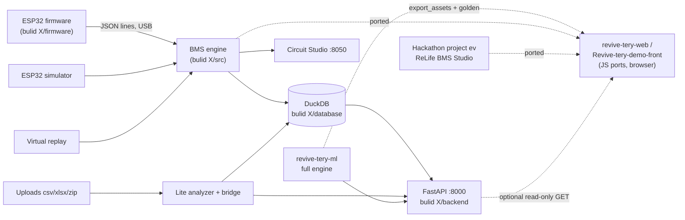
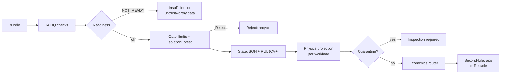

# REVIVE-TERY: Workflow of Each Folder

How each of the five folders runs, step by step: entry point, data in, data out, how to run it, how to test it.
Derived from the code and READMEs (2026-11-05). For the engine list see [PROJECT_INVENTORY.md](PROJECT_INVENTORY.md).

## 0. How the folders connect



The only hard coupling between ML and everything else is the **data contract** (bundle = `metadata.json` + `telemetry.csv|parquet`). The ML package imports nothing from the other folders.

---

## 1. `bulid X`: Circuit Studio, backend, firmware, database

**Entry points:** `src/app.py` (Dash, http://127.0.0.1:8050) · `backend/revive_api/main.py` (FastAPI, http://127.0.0.1:8000) · `firmware/revive_tery_esp32/revive_tery_esp32.ino`.

| Sub-folder | Contents | Role |
|---|---|---|
| `src/` | `app.py`, `bms_engine.py`, `esp32_sim.py`, `run_controller.py`, `test_bench.py`, `ml_panel.py`, `ml_analyzer_suggester.py`, `ml_engine_bridge.py`, `backend_connector.py`, `build_relational_db.py`, `make_ml_samples.py` | Dashboard + engines |
| `backend/` | `revive_api/{main,db,schemas,settings}.py`, `services/{assess,batteries,ingest,runs}.py`, `tests/` | HTTP service over DB, runs, uploads, assessments |
| `firmware/` | ESP32 `.ino` sketch | Sensor → USB JSON |
| `database/` | `csv_bundle/` (8 demo tables), `database/revive_tery.duckdb`, `ml_samples/` (7 synthetic uploads) | Data |
| `graphify-out/` | knowledge-graph report | Navigation aid |

**Workflow A: live run (Circuit Studio)**
1. `build_relational_db.py` builds DuckDB from `database/csv_bundle/` (one-time; the `.duckdb` is not in git).
2. `app.py` starts; user picks a source: **Virtual replay** (DB telemetry), **Simulated ESP32** (with fault injection) or **Real ESP32** (serial port, read-only).
3. `RunController` starts a thread: samples → `BMSEngine` → readings (V, I, T, SOC by coulomb counting, SOH with basis) → `TelemetryLogger` writes `test_run_log`.
4. `refresh()` callback polls `RunController.snapshot()`, draws KPIs, gauges, traces, fault banner (stale reading > 3 s), decision card at end of run.

**Workflow B: assess an upload**
1. User uploads `.csv/.xlsx/.zip` in the ML panel (or `POST /api/uploads`).
2. `BatteryFileExtractor` normalises headers; `DuckDBSeeder` stores rows in `ml_telemetry`, logs in `ml_ingest_log`.
3. `ml_engine_bridge` tries to build a **contract bundle**. If timestamps or a capacity test are missing it raises `AdapterError` with the reason.
4. `engine=auto`: full engine (`revive_ml.pipeline.assess`) else fall back to the **lite** analyzer and report why; `full` or `lite` force a path.
5. `summarize_full` / `summarize_lite` produce a card summary; the whole report is saved in `assessments`.

**Workflow C: backend** (`uvicorn revive_api.main:app`)
`settings.py` puts `src/` on `sys.path` and points `bms_engine.DB_PATH` at `REVIVE_DB` or `data/database/revive_tery.duckdb` → `db.py` is the only door to DuckDB (single writer, shared lock) → routers in `main.py` call `services/*`. Local only (127.0.0.1), no login, hardware read-only.

**Run:** `py -3.13 -m venv .venv-studio` → `pip install -r src\requirements.txt` → `python src\build_relational_db.py` → `python src\app.py`. API: install `backend\requirements.txt` + `-e ..\revive-tery-ml`, then uvicorn.
**Test:** `pytest` in `backend/` (runs on a scratch copy of the DB, never the project file).

---

## 2. `revive-tery-ml`: the decision engine

**Entry points:** `revive-ml` CLI (`src/revive_ml/cli.py`) · `revive_ml.pipeline.assess(bundle)` · `uvicorn revive_ml.api:app` · `justfile` targets.

**Workflow: `assess(bundle)`**

Rules: any DQ `fail` → stop; `warn`/`inconclusive` → continue with warnings and exclude that quantity; every number carries a provenance tag; current sign is never flipped.

**Workflow: training and validation (offline)**
`just download` (Severson 8.3 GB + NASA PCoE, SHA-256 logged) → `just etl` (.mat → parquet, cleaning, windows) → `just train` (state RUL, grouped CV, CV+) → `just train-gate` (OOD filters) → `just validate-dq` (100 held-out bundles) → `just physics-check` → `just sweep` → `just demo` (assess both example bundles → `out/*.json`).

**Layout:** `configs/` (YAML single source of tunables) · `src/revive_ml/{dq,gate,state,physics,econ}` · `models/` (joblib) · `reports/` (validation JSON) · `docs/model_cards/` · `examples/` (demo + clean bundles) · `tests/` (one file per stage).
**Run:** `py -3.13 -m venv .venv` → `pip install -e ".[dev,api]"` → `just demo`. **Test:** `just test` (pytest), `just lint` (ruff).
Seeds fixed at 0. Raw datasets cached outside the repo (`REVIVE_ML_CACHE`).

---

## 3. `Hackathon project ev (3)`: ReLife BMS Studio

**Entry point:** `main.py` → `app_ui.py` main window (PySide6). Simulation only.

| Page | Module | Workflow |
|---|---|---|
| Overview | `app_ui.py` | DB status, linked pack, workflow |
| Pack data | `pack_page.py` + `database.py` | Reads telemetry/health/events; **Import data** (zip/folder/CSVs) validated per file, replaces tables in one transaction, keeps newest 3 backups |
| Batteries | `catalog_page.py` + `battery_details.py` | Search DB packs, own entries, 23 research records; add battery / import profile CSV; stored in `battery_catalog.json` |
| Circuit Studio | `circuit_page.py` + `circuit_studio.py` | Draggable conceptual schematic; select part → connections |
| Test bench | `bench_page.py` + `bms_engine.py` + `models.py` | Choose Charge/Discharge, voltage, demand; 30 s synthetic pulse; SOC by coulomb counting; SOH from `R ≈ |ΔV|/|ΔI|` impedance proxy; **Inconclusive** if resistance pegs outside 10–500 % of reference |

Shared: `app_state.py` (cross-page data), `widgets.py` (cards, tables, charts, background tasks), `theme.py` (all colours).
DB link: finds `revive_tery.duckdb` in this folder and up to three levels above (including `bulid X/data/database/`), skipping empty files; **Change database** overrides and is remembered.
**Run:** `pip install -r requirements.txt` → `python main.py`. **Test:** `$env:PYTHONPATH="tests"; python -m unittest discover -s tests`.
Git: repo with branches `main`, `bms-engine`.

---

## 4. `revive-tery-web` and `Revive-tery-demo-front`: Web Studio

**Entry point:** `index.html` → `assets/js/app.js`. No server logic, no build step; serve statically (`python -m http.server 8080`) or GitHub Pages (`.nojekyll`, hash routing `#/page`).

**Workflow: boot** → inline script applies saved theme → `app.js` builds nav → `boot()` runs `Promise.all` loading `data/configs.json`, model JSONs (state RUL, 2 gate OOD, MC draws), `relife.json`, `circuit.json`, 8 demo CSV tables → builds `StateModel`, `OODFilter`s, parses CSVs, restores uploads/history/run log from `localStorage` → router `import("./pages/<id>.js")` and `render(root, app)`.

**Pages (Variant B `revive-tery-web`):** overview · bench (Circuit Studio: replay / simulator / Web Serial) · analyze · dqlab (tabs: Data quality, Physics projection, Economics, Field test) · database · evidence · relife · hardware · backend.
**Variant A `Revive-tery-demo-front`** has the same plus separate `physics` and `economics` pages, `lib/duckdb.js` (DuckDB-WASM reads `data/db/revive_tery.duckdb`, falls back to `data/demo/*.csv`) and a built-in backend page; it also carries `WORKFLOW.md` and an earlier `MASTER_PROMPT.md`.

**Workflow: regenerate and verify (Python → JS parity)**
```
revive-tery-ml + bulid X + ReLife (Python)
   ├─ tools/export_assets.py  → data/* (asserts NumPy prediction == sklearn/MAPIE before writing)
   └─ tools/make_golden.py    → tests/golden/*.json
        └─ tools/make_bundles.mjs → data/bundles.json
npm test (node --test, 41 parity tests: 23 pipeline cases, models to 1e-9, physics, econ sweep, lite, BMS, ESP32 line sequence, ReLife)
```
**Rule:** engines in `assets/js/engines/` are ports; change the Python original first, then re-export and re-run parity tests.
**Run:** `npm install` → `npm test` → `python -m http.server 8080`.

---

## 5. Cross-folder rules (hold everywhere)

1. **Provenance on every number**: `measured | modelled | assumed | synthetic`.
2. **Never invent a value**: missing timestamps/capacity/temperature → report it, fall back or refuse with a reason.
3. **Hardware is monitor-only**; bench is low-voltage only (INA219 26 V). Never connect to an EV pack.
4. **Synthetic data stays labelled synthetic**; the gate is "UL 1974-style triage", not certification.
5. **DuckDB has one writer**: close the other writer first.
